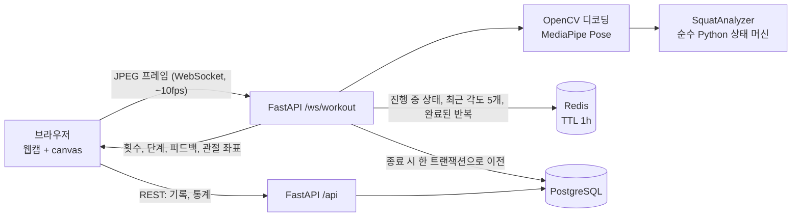

# Squat Coach — 웹캠 스쿼트 자세 코치

브라우저 웹캠으로 스쿼트를 하면 서버가 **실시간으로 횟수를 세고 자세를 피드백**합니다. 운동이 끝나면 기록이 저장되고 주간 추이, 자주 하는 실수 같은 통계를 볼 수 있습니다.

- **영상 처리:** OpenCV(디코딩, 리사이즈) + MediaPipe Pose(관절 좌표)
- **실시간 처리:** FastAPI WebSocket, 최신 프레임만 처리하는 백프레셔
- **진행 중 세션:** Redis (TTL 1시간)
- **영구 기록, 통계:** PostgreSQL (SQL 집계, 윈도 함수)
- **화면:** 바닐라 JS 단일 페이지

> 시연 영상: _(녹화 후 링크 추가)_

## 아키텍처



### 왜 Redis와 PostgreSQL을 나눴나
| | Redis | PostgreSQL |
|---|---|---|
| 담는 것 | 진행 중인 세션의 상태(단계, 횟수, 최근 각도 5개, 완료된 반복) | 끝난 세션과 반복별 기록 |
| 쓰기 빈도 | 프레임마다 (초당 약 10회) | 세션당 1번 |
| 수명 | TTL 1시간, 종료 시 삭제 | 영구 |
| 장애 시 | 진행 중 세션만 잃음 | 저장 실패 시 Redis 데이터를 지우지 않고 재시도 |

프레임마다 DB에 쓰지 않으므로 PostgreSQL 부하가 거의 없고, 통계 쿼리는 깨끗한 확정 데이터만 다룹니다.

### 스쿼트 판정
- 엉덩이-무릎-발목 각도(앉은 깊이)와 어깨-엉덩이 선의 기울기(상체 숙임)를 5프레임 이동 평균으로 계산합니다.
- 상태 머신 `STANDING → DESCENDING → BOTTOM → ASCENDING → STANDING(1회)`. 하강 기준(140°)과 기립 기준(160°)을 다르게 둬서 경계에서 중복 집계를 막습니다(히스테리시스).
- 피드백: 최저 무릎 각도가 100°보다 크면 "더 깊이 앉으세요", 상체 기울기가 45°를 넘으면 "상체를 세우세요". 반복마다 0~100점.
- 기준값은 `config/thresholds.toml`에 있어 코드 수정 없이 조정합니다.

## 실행 방법 (Windows PowerShell 기준)

필요한 것: Python 3.11 (MediaPipe 0.10.14는 3.8~3.12 지원), Docker Desktop.

```powershell
docker compose up -d                 # PostgreSQL 16 + Redis 7 (스키마 자동 적용)
py -3.11 -m venv .venv
.venv\Scripts\activate
pip install -r requirements-dev.txt
copy .env.example .env
uvicorn app.main:create_app --factory
```

http://localhost:8000 을 엽니다. 카메라는 `localhost` 또는 HTTPS에서만 동작합니다. 카메라에서 2~3m 떨어져 **옆모습 전신**이 보이게 서 주세요.

API 문서(OpenAPI): http://localhost:8000/docs

## 테스트

```powershell
pytest -m "not integration"   # 분석기, 각도 계산, 포즈 추출 (DB 불필요)
pytest                        # 전체 (docker compose up -d 필요)
node tests/e2e/workout_ui.js http://localhost:8000   # 브라우저 동작 (서버 실행 + npm i playwright 필요)
```

| 영역 | 내용 |
|---|---|
| 분석기 | 합성 각도 시퀀스로 횟수, 히스테리시스, 화면 이탈, 점수, 피드백 검증 |
| 실제 영상 | `tests/data/squat_5reps.mp4`가 있으면 기대 횟수와 비교 (없으면 건너뜀) |
| Redis/저장 | TTL, 최근 5개 유지, 세션 격리, Redis→PostgreSQL 트랜잭션 이전, DB 장애 시 데이터 보존 |
| WebSocket | 시작→프레임→종료→요약, 비정상 종료 시 `abandoned` 저장, 잘못된 입력 오류, 동시 접속 |
| 브라우저 | 서버 오류 메시지 표시, 권한 요청 중 화면 이동 시 카메라 해제 |
| REST | 페이지네이션, 점수 변화(lag), 주간 집계, 실수 순위(unnest), 빈 사용자 |

### 기준값 튜닝
1. 옆모습으로 스쿼트를 정확히 5회 한 영상을 찍어 `tests/data/squat_5reps.mp4`로 저장합니다.
2. `pytest tests/test_pose.py -v`를 실행합니다.
3. 횟수가 틀리면 `config/thresholds.toml`의 `descend_below`, `stand_above`를 조정하고 다시 실행합니다.

## 알려진 한계
- **인증이 없습니다.** `client_id`는 브라우저가 만든 UUID일 뿐이며 보안 수단이 아닙니다. ID를 아는 사람은 해당 기록을 조회할 수 있습니다.
- 운동은 스쿼트 하나만 지원합니다.
- 영상 분석은 서버 CPU에서 동작합니다(프레임당 약 16ms). 동시 접속이 많으면 서버 자원이 병목입니다.
- 연결이 끊기면 세션은 `abandoned`로 저장되고, 이어서 하기는 지원하지 않습니다.
- 각도 기준값은 일반적인 초기값이며 사람과 카메라 각도에 따라 튜닝이 필요합니다.

## 프로젝트 구조
```
app/analyzer/   각도 계산, 스쿼트 상태 머신, 점수 (서버/DB 의존 없음)
app/pose.py     OpenCV 디코딩 + MediaPipe 관절 추출
app/ws.py       WebSocket 스트림, 최신 프레임 슬롯
app/redis_store.py  진행 중 세션 상태
app/finalize.py     Redis → PostgreSQL 이전 (재시도)
app/repository.py   SQL (저장, 조회, 통계)
app/api.py      REST API
static/         바닐라 JS 화면 (운동, 기록)
sql/schema.sql  DB 스키마
docs/superpowers/   설계 문서, 구현 계획
```

## 수동 확인 목록

Run with `uvicorn app.main:create_app --factory`, open http://localhost:8000 (the camera only works on `localhost` or HTTPS).

### Workout screen
- [ ] The camera permission prompt appears when you press "운동 시작".
- [ ] The count goes up exactly once per squat.
- [ ] A shallow squat shows "더 깊이 앉으세요".
- [ ] Stepping out of frame shows "전신이 보이게 서주세요".
- [ ] "종료" shows the summary (reps, average score) and the camera light turns off.
- [ ] Reloading the page keeps the same `client_id` (localStorage `squatcoach.client_id`).
- [ ] Stopping the server mid-workout shows a visible error and the camera is released.

### History screen
- [ ] A new browser (no records) shows the empty-state text, not an error.
- [ ] After a workout, the session is at the top of the list with the correct rep count.
- [ ] Clicking a session lists its reps in order; "← 목록" goes back.
- [ ] The mistakes ranking matches the feedback shown during the workout.
